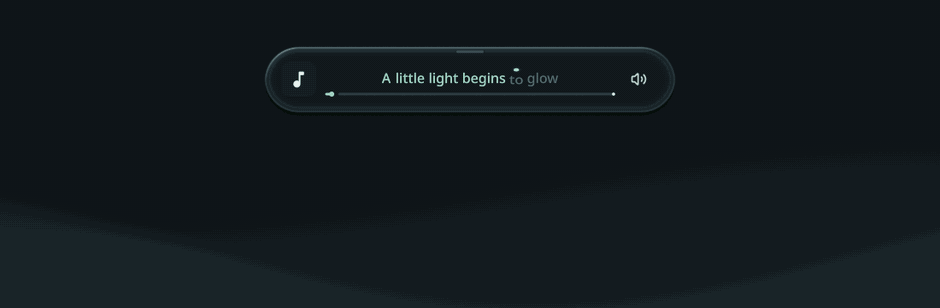
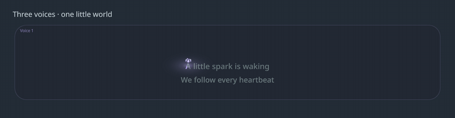
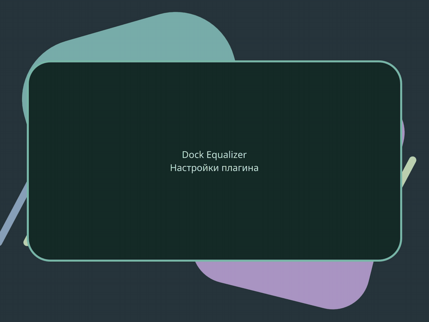

# SekaiPOP Dock Equalizer & Living Wallpapers

A music dock with timed lyrics and living glass wallpapers for **SekaiPOP on Hyprland**. The interface follows the system colours, and the integrated Music Palette can apply temporary colours from the current cover. [SekaiPOP](https://github.com/Blapples/SekaiPop)

> **3.0.0-rc.4 · native extensions preview.** This build requires SekaiPOP with the extension API. The tested shell patch targets commit `e629dfe`. The adapter-based stable release is 2.23.0. [Shell patch and compatibility](docs/NATIVE-INTEGRATION.md) · [Stable release](https://github.com/Aferon-08/sekaipop-dock-equalizer/releases/tag/v2.23.0)

[Русский](README.md) · [Installation](#installation) · [Settings](docs/SETTINGS.md) · [Troubleshooting](docs/TROUBLESHOOTING.md) · [Changelog](CHANGELOG.md)

## Music dock

Spectrum light lives inside the side capsules in compact mode. When the dock expands, the capsules flow into its body and soft frequency glows appear at its edges. The player shows cover art, controls, wavy progress and timed lyrics. Hovering restores the app icons. [MP4 video](docs/media/dock.mp4)

Progress, lyrics and local recording share one playback clock. It handles brief zero position reports and confirmed seeks. The spectrum follows the system output, adapts its gain smoothly and releases capture on pause.

## Living wallpapers

Each monitor gets a separate composition with a shared palette. Shapes appear after the background and lighting settle. The firefly travels inside the glass, crosses tubes or rides a bubble. It follows a confident beat, breathes gently in silence and occasionally splits into two companions that roam independently. [MP4 video](docs/media/wallpaper.mp4) · [Wallpaper guide](docs/WALLPAPERS.md)

## Lyrics and voices

A bouncing marker follows the words, with a separate firefly trailing it. Vocal parts can occupy their own glass panels, merge for a shared chorus and show backing phrases beside the lead. The expanded player stays open on pause and the progress wave flattens. [MP4 video](docs/media/voices.mp4) · [Lyrics guide](docs/USAGE.md)

The optional local engine aligns supplied lyrics with audio and estimates vocal parts. Separation quality depends on the recording and the available lyrics. JSON import, CPU processing and a separate NVIDIA CUDA environment are available. [Data and limitations](docs/PRIVACY.md)

## Liquid settings panel

The plugin settings button opens a glass panel with search and 63 controls. A master switch turns the dock glass on or off, with separate settings for refraction, frost, tint and light. The audio section offers a silent check of the output monitor and spectrum. The settings UI is primarily in Russian. [MP4 video](docs/media/settings.mp4) · [Settings catalogue](docs/SETTINGS.md)

The gallery was captured from the QML components of this build in isolated scenes. It uses a synthetic spectrum, sample lyrics and a mock phone. Vocal parts are tagged for the demo, and the wallpaper split is triggered early to fit the clip.

## Installation

1. Prepare SekaiPOP with the documented extension API. Apply the shell patch to the compatible shell checkout. [Integration guide and requirements](docs/NATIVE-INTEGRATION.md)
2. Copy the contents of the package folder into `~/.config/sekaipop/plugins/dock-equalizer/` and restart SekaiPOP. [3.0.0-rc.4 package](https://github.com/Aferon-08/sekaipop-dock-equalizer/releases/tag/v3.0.0-rc.4)
3. Open **SekaiPOP Settings → Desktop → Plugins → Dock Equalizer**. To follow cover colours, enable the integrated Music Palette setting and disable the standalone Music Palette plugin if installed.

Basic visuals use an MPRIS player, CAVA and either PipeWire-Pulse or PulseAudio. The ML engine is optional. [Dependencies and upgrades](docs/INSTALL.md)

## Recording and analysis

**Spotify recording is on by default.** The plugin saves the local Spotify playback stream when a track plays from the beginning. The recording setting turns it off. Recordings use about 10 MB per minute.

Heavy analysis starts on request through the glass-area button or the regenerate action. Model setup, lyric retrieval and the YouTube source may use the network. Inference runs locally. [Privacy and storage](docs/PRIVACY.md)

## Project

- [Architecture, shaders and demo reproducibility](docs/DEVELOPMENT.md)
- [Audio, glass and playback troubleshooting](docs/TROUBLESHOOTING.md)
- [Changelog](CHANGELOG.md)
- [Third-party projects](THIRD_PARTY.md) · [Contributing](CONTRIBUTING.md)

An independent extension licensed under [GNU GPL v3](LICENSE).
