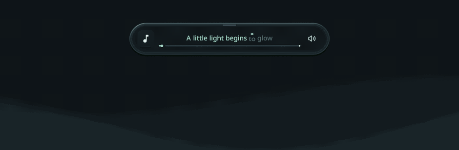
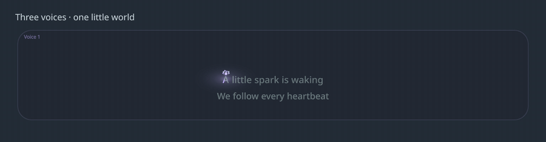
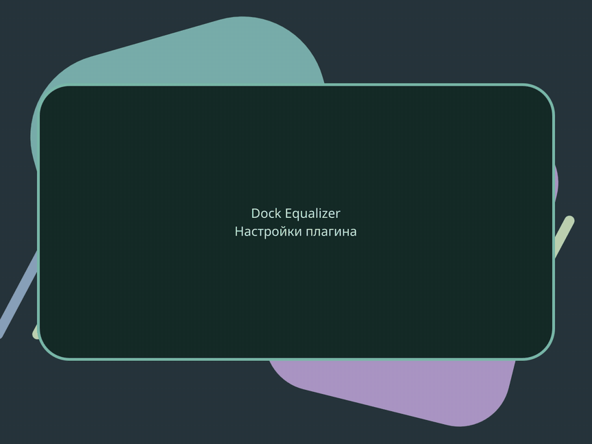

# SekaiPOP Dock Equalizer & Living Wallpapers

Музыкальный док с лирикой и живые стеклянные обои для **SekaiPOP на Hyprland**. Цвета следуют теме системы. Во время музыки встроенный Music Palette может подобрать временную палитру по обложке. [SekaiPOP](https://github.com/Blapples/SekaiPop)

> **3.0.0-rc.4 · предварительная версия.** Для запуска нужен SekaiPOP с API расширений. Проверенный патч рассчитан на commit `e629dfe`. Стабильная версия с прежними адаптерами доступна как 2.23.0. [Патч и совместимость](docs/NATIVE-INTEGRATION.md) · [Стабильная версия](https://github.com/Aferon-08/sekaipop-dock-equalizer/releases/tag/v2.23.0)

[English](README.en.md) · [Установка](#установка) · [Настройки](docs/SETTINGS.md) · [Диагностика](docs/TROUBLESHOOTING.md) · [Изменения](CHANGELOG.md)

## Музыкальный док

В компактном виде спектр светится внутри боковых капсул. При раскрытии они сливаются с основным доком, а по краям остаются мягкие световые эквалайзеры. Внутри стеклянного плеера видны обложка, название, управление, волнистый прогресс и лирика. При наведении возвращаются иконки приложений. [Видео MP4](docs/media/dock.mp4)

Прогресс, лирика и локальная запись получают время из одной модели. Временное нулевое чтение позиции пропускается, подтверждённая перемотка сразу меняет позицию. Эквалайзер следует за системным аудиовыходом, плавно подстраивает чувствительность и освобождает захват на паузе.

## Живые обои

Каждый монитор получает свою композицию с общей палитрой. Фигуры появляются после фона и света, учитывают положение бара и виджетов. Огонёк путешествует внутри стекла по трубам и в пузырьках. Он подхватывает уверенный ритм, спокойно дышит в тишине и иногда разделяется на двух спутников с самостоятельными маршрутами. [Видео MP4](docs/media/wallpaper.mp4) · [Как устроены обои](docs/WALLPAPERS.md)

## Лирика и голоса

Прыгающая точка отмечает слово, отдельный огонёк оставляет за ней мягкий след. Для разных голосов появляются стеклянные области. Общий припев объединяет их, а короткие подпевки выводятся у основной строки. При паузе плеер остаётся открыт, волна прогресса выравнивается. [Видео MP4](docs/media/voices.mp4) · [Руководство по лирике](docs/USAGE.md)

Опциональный обработчик выравнивает готовый текст по аудио и анализирует голоса локально. Качество разделения зависит от записи и текста. Доступны импорт JSON, CPU и отдельное NVIDIA CUDA-окружение. [Данные и ограничения](docs/PRIVACY.md)

## Стеклянная панель настроек

Кнопка в настройках плагина раскрывает стеклянную панель с поиском и 63 параметрами. Можно выключить стекло дока одним переключателем, изменить преломление, матовость, затемнение и силу света. В разделе **Звук** есть бесшумная проверка монитора выхода и спектра. [Видео MP4](docs/media/settings.mp4) · [Каталог настроек](docs/SETTINGS.md)

Галерея записана из QML-компонентов этой сборки в изолированных сценах. В ней использованы синтетический спектр, примеры текста и тестовый макет телефона. В демонстрации нескольких голосов партии заданы вручную, а разделение огонька на обоях запускается раньше для короткого ролика.

## Установка

1. Подготовьте SekaiPOP с описанным API расширений. Патч применяется к исходникам оболочки отдельно. [Инструкция и требования](docs/NATIVE-INTEGRATION.md)
2. Скопируйте содержимое папки из архива в `~/.config/sekaipop/plugins/dock-equalizer/` и перезапустите SekaiPOP. [Архив 3.0.0-rc.4](https://github.com/Aferon-08/sekaipop-dock-equalizer/releases/tag/v3.0.0-rc.4)
3. Откройте **Настройки SekaiPOP → Desktop → Plugins → Dock Equalizer**. Для смены системных цветов включите **Музыкальная палитра → Цвета системы по обложке** и отключите отдельный Music Palette, если он установлен.

Для обычной визуализации достаточно MPRIS-плеера, CAVA и PipeWire-Pulse либо PulseAudio. Дополнительные модели устанавливаются по запросу. [Зависимости и обновление](docs/INSTALL.md)

## Запись и анализ

**Запись Spotify включена по умолчанию.** Плагин локально сохраняет поток самого Spotify при воспроизведении трека с начала. Параметр **Запись Spotify для лирики** отключает запись. Расход составляет около 10 МБ в минуту.

Тяжёлый анализ запускается только по запросу через кнопку в стеклянной области или команду **Перегенерировать**. Получение лирики, моделей и YouTube-источника может требовать сеть. [Подробнее о данных](docs/PRIVACY.md)

## Проект

- [Устройство плагина, шейдеры и воспроизведение демонстраций](docs/DEVELOPMENT.md)
- [Диагностика звука, стекла и прогресса](docs/TROUBLESHOOTING.md)
- [История изменений](CHANGELOG.md)
- [Сторонние проекты](THIRD_PARTY.md) · [Как помочь проекту](CONTRIBUTING.md)

Независимое расширение под лицензией [GNU GPL v3](LICENSE).
